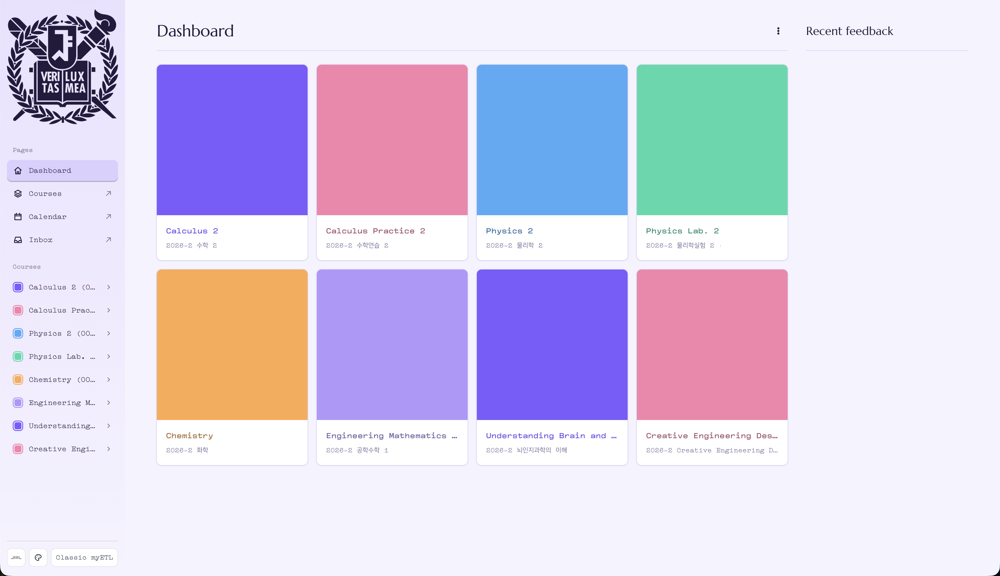

# Neo eTL

A browser extension that gives SNU myETL a new interface. It runs locally in your browser and only on `myetl.snu.ac.kr`.

## Features

- Dashboard with courses, deadlines and recent feedback.
- Course views for assignments, announcements, files, modules, grades and syllabus.
- Themes, card styles, fonts and wallpaper, saved in your browser.
- Exam and embedded tool safeguards; see [Privacy and safety](#privacy-and-safety).

## Install

For Chrome, Edge, Brave or Whale:

1. Open `chrome://extensions` and enable **Developer mode**.
2. Select **Load unpacked** and choose this repository's `extension` folder.
3. Sign in to myETL as usual.

## Privacy and safety

- Runs only on `https://myetl.snu.ac.kr`; no server, analytics or remotely hosted code.
- Uses the existing myETL session. The only write marks an announcement read when opened.
- Stores preferences, deadline ticks and pictures in this browser only.
- Skips quiz and external tool pages. Embedded exams open as the normal myETL page.
- Does not change submissions, quizzes or grades.

## Credits

Fonts in `extension/fonts`:

- Pretendard, copyright 2021 Kil Hyung-jin; SIL OFL 1.1 (see `OFL.txt`), Reserved Font Name Pretendard.
- NanumSquare, copyright 2016 NAVER Corporation, drawn by Sandoll Communications; free to use and redistribute, not to sell.

The SNU emblem is included for personal use; check SNU's UI guidelines before redistributing the extension.
